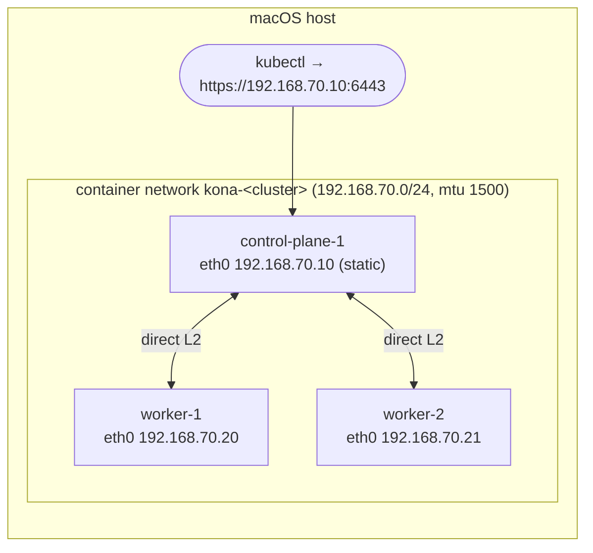

# Networking design

Status: **every node is an Apple `container` VM on one `container` network
per cluster.** Nodes, the host and the API server reach each other directly
on that network: no tunnel, no NAT and no published ports. GPU nodes
(krunkit VMs on a second vmnet network, linked over WireGuard) were removed
on 2026-11-08 and live on the `gpu` branch.

## Design

- **Node IP** = the node's static address from the cluster /24
  (`internal/netplan`): control planes at `.10+`, workers at `.20+`, the
  registry at `.200`. The node entrypoint makes it the primary `eth0`
  address (finding 5). kona stores it in state, and it's identical across
  recreates. k3s: `--node-ip <ip> --advertise-address <ip> --flannel-iface eth0`.
  kubeadm: `--apiserver-advertise-address <ip>`.
- **Node↔node**: direct L2 on the cluster's vmnet bridge, with no
  encapsulation other than the CNI's.
- **MTU**: the underlay is 1500 (finding 6). flannel and Cilium pick their
  VXLAN MTU (1450) from it.
- **API server from the host**: `https://<control-plane static IP>:6443`,
  reachable directly because the host sits on the container bridge (verified
  in Phase 1, see [gates.md](gates.md)). There's no port publish. The cert SANs
  include every control-plane IP and name.
- **No NAT** between nodes, and **no sudo** anywhere.

## Wi-Fi change behavior (verified)

`spikes/03-net/wifi-toggle.sh` ran twice. It turns Wi-Fi off for ~8 s, then
back on. Outputs are in `wifi-toggle-run1.txt` and `wifi-toggle-run2.txt`.

| Path | Wi-Fi off | Wi-Fi back |
|------|-----------|------------|
| vmnet bridges | kept | kept |
| host → node static IPs | ok | ok |
| node ↔ node (direct L2) | ok | ok |
| node → internet (vmnet NAT) | fails, as expected | ok |

vmnet networks are host-local and don't depend on the uplink, so Wi-Fi
changes never touch intra-cluster paths.

## CNI

| `--cni` | k3s | kubeadm |
|---|---|---|
| `default` | k3s's built-in flannel (VXLAN, `--flannel-iface eth0`), plus kube-proxy | flannel v0.28.9 (embedded manifest, VXLAN), plus kube-proxy |
| `cilium` | `--flannel-backend none --disable-network-policy --disable-kube-proxy` | `kubeadm init --skip-phases=addon/kube-proxy`, no flannel |

Cilium (v1.20.2) is installed from the host by the pinned Cilium CLI
(v0.20.1). kona downloads the CLI, verifies its sha256, and caches it under
`~/Library/Application Support/kona/bin/`. Settings:

- `kubeProxyReplacement=true`, with `k8sServiceHost` set to the first
  control plane's static IP, since there's no kube-proxy to program the
  `kubernetes` Service.
- `routingMode=tunnel`, `tunnelProtocol=vxlan`. The tunnel keeps pod
  routing independent of the underlay.
- `ipam.mode=kubernetes`: pod CIDRs come from the node objects (k3s
  10.42.0.0/16, kubeadm 10.244.0.0/16).
- Hubble with relay.
- CNI paths are Cilium's defaults for both distros. With
  `--flannel-backend none`, k3s leaves containerd on `/etc/cni/net.d` and
  `/opt/cni/bin`.

Install order: control plane → API ready → Cilium → remaining nodes → all
Ready → `cilium status --wait`. Nodes can't become Ready before the CNI runs.

Node requirements Cilium surfaced (details in [failure-modes.md](failure-modes.md)):
shared mount propagation for `/` and `/sys/fs/bpf` inside node VMs, and
`CONFIG_INET_DIAG` + `CONFIG_INET_UDP_DIAG` + `CONFIG_INET_DIAG_DESTROY` in
the guest kernel.

Cilium 1.20 is e2e-tested on Kubernetes 1.33–1.36. kona's default 1.37 is
outside that list, but the full `cilium connectivity test` passes on it for
both distros ([gates.md](gates.md)).

## Phase 0 findings (macOS 26.6.2 / container 1.4.1 / vmnet-helper 0.13.0)

All of these come from real runs, in `spikes/03-net/*.txt` and [gates.md](gates.md).
Items 1–4, 7 and 9 concern krunkit GPU nodes, which kona no longer has; they are
kept because they explain the GPU design on the `gpu` branch.

1. **krunkit cannot join a `container` network.** `container` creates its
   networks with macOS 26's `vmnet_network` API inside its own XPC plugin
   (`container-network-vmnet`). A vmnet-helper interface asking for the same
   subnet fails with `vmnet_start_interface: (unknown status)`.
2. **Separate vmnet networks are isolated from each other**, even though the
   host has `net.inet.ip.forwarding=1` and connected routes to every bridge.
   tcpdump shows a container's echo request entering `bridge102` and never
   leaving on `bridge101`. Two `container` networks (`default` and
   `kona-spike`) can't reach each other either. The filter isn't visible
   without root (`pfctl` needs `/dev/pf`).
3. **vmnet-helper instances with the same subnet share one bridge.** Every
   krunkit node on 192.168.65.0/24 lands on the same `bridge101` (L2
   adjacent), so GPU↔GPU traffic is direct.
4. **A vmnet-helper that asks for a colliding subnet can hang forever** in
   `vmnet_start_interface` (SIGTERM is ignored while it blocks). Any later
   helper reusing the same `--interface-id` hangs too. kona runs helpers with
   a 10 s start timeout, SIGKILLs on timeout, and generates a fresh interface
   ID per start.
5. **`container` IPs are not stable.** The address is allocated sequentially
   per run and **not** tied to the pinned MAC (the same MAC got .5, then
   .6). There is no `--ip` flag. A secondary static address added in the guest
   (`ip addr add`) is reachable from peers on that network **and from the
   host**.
6. **Default container MTU is 1280.** `--network <net>,mtu=1500` works.
   vmnet-helper networks are 1500.
7. **Published ports work for UDP.** `container run -p 51821:51821/udp` is
   served by a userspace proxy in `container-runtime-linux`. A krunkit VM
   reaches it at its own gateway (`192.168.65.1:51821`), and the container sees
   the source as its own gateway (`192.168.66.1:<port>`), so it is NATed.
   On container 1.7.1 (macOS 27.2, 2026-11-08) TCP published ports work too,
   whether or not the runtime's macOS Local Network rule is allowed
   ([failure-modes.md](failure-modes.md)).
8. **The vmnet gateway DNS forwarder can be broken.** On this host
   `192.168.64.1:53` refuses queries while `8.8.8.8` works. kona always passes
   the host's first IPv4 resolver explicitly (`--dns`, cloud-init
   `nameservers`), and the builder does the same (`container build --dns`).
9. **Unix socket paths are limited to 103 bytes.** Helper and krunkit API
   sockets live under `/tmp/kona-<uid>/<cluster>/` (0700), not in
   `~/Library/Application Support/...`.

## Options evaluated for linking GPU nodes (Phase 0)

| Option | Result | Notes |
|--------|--------|-------|
| (a) krunkit on the same vmnet subnet as `container` | **Not possible** | The subnet is refused (constraint 1). A routed separate subnet is really option (b). |
| (b) Route through the host (`pf` / `ip.forwarding`) | **Blocked by default**, and the fix is unverified | Forwarding is already on and routes exist, but the bridges are isolated (constraint 2). A kona pf anchor with `pass` rules between the kona bridges *might* lift it. That needs `sudo pfctl` to inspect Apple's `com.apple/*` anchors and to load an anchor. |
| (c) WireGuard overlay between nodes | **Works without root** | 0% loss both ways. The overlay preserves source IPs (tcpdump on `wg0` shows 10.99.0.x on both ends). With a 1500 underlay, the full 1420 MTU passes with DF. ~365 Mbit/s each way through the published-port proxy (the bottleneck is the proxy, not WireGuard). |
| rejected: L2 relay through a "gateway" container (`--publish-socket` + krunkit `unixstream`) | Not pursued | vmnet filters per-VM MACs. It would need bridging/promiscuous mode inside a guest, is fragile, and still runs through a userspace hop. |
